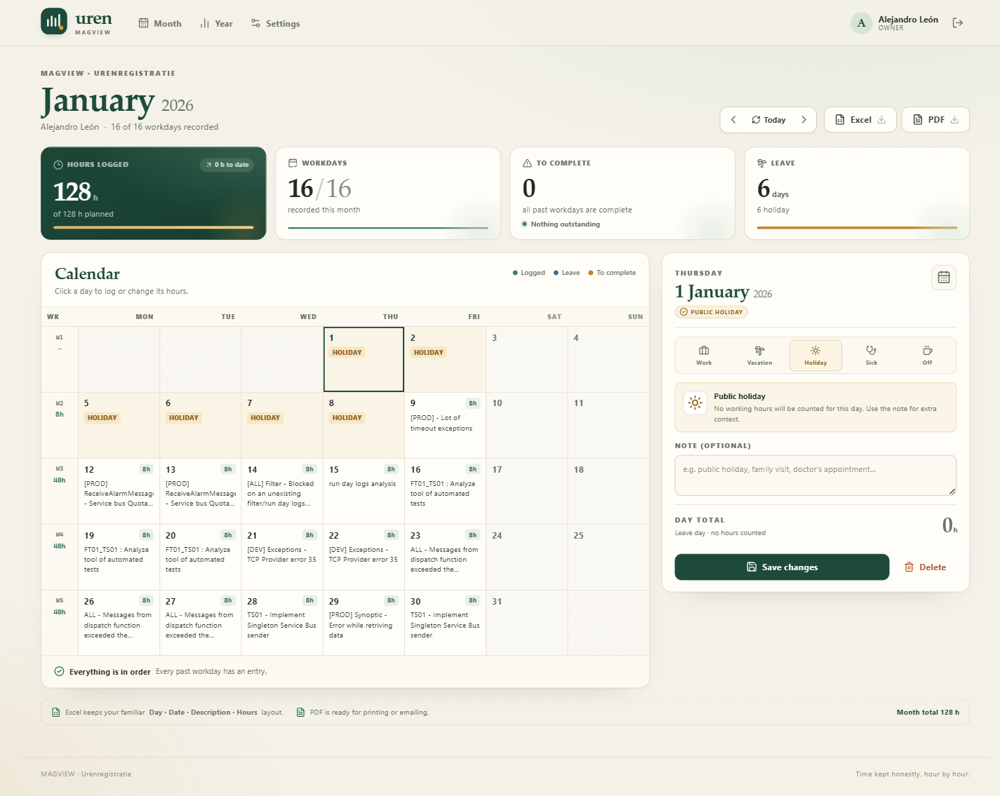

# Uren — registro de horas para MAGVIEW

Aplicación web para registrar el trabajo diario, las horas y los días libres (vacaciones, festivos, enfermedad o día libre), y generar los reportes mensuales en Excel y PDF que ya usas hoy. Tu jefe puede entrar con un enlace de solo lectura, revisar cualquier mes y descargar los reportes sin poder editar nada.

La app mantiene el formato de tus planillas: **Day · DATE · Description · hours**, agrupado por semanas de lunes a viernes, con el total mensual y el resumen de ausencias.



---

## Lo que incluye

- Calendario mensual con todas las semanas del año, total semanal y estado de cada día.
- Registro por día con varias entradas (por ejemplo: 6 h de un ticket + 2 h de reuniones).
- Tipos de día: trabajo, vacaciones, festivo, baja por enfermedad y día libre.
- Notas por día y cálculo de balance frente al objetivo diario.
- Días pendientes de registrar o sin descripción, señalados en el calendario.
- Vista anual con horas por mes, balance, días trabajados, ausencias y días faltantes.
- Exportación mensual y anual a **Excel** y **PDF**.
- Enlace público de solo lectura para tu jefe, revocable en un clic.
- Cuentas de usuario: propietario (edita) y lector (solo consulta y descarga).
- Copia de seguridad JSON de todos los registros.
- Base de datos SQLite local; no depende de servicios externos ni de una cuenta en la nube.

---

## Requisitos

- Windows, macOS o Linux.
- **Node.js 24 o superior** (la app usa el módulo SQLite integrado de Node).
- No hace falta instalar una base de datos aparte.

Comprueba la versión con:

```bash
node --version
```

Debe mostrar `v24.x` o superior.

---

## Cómo arrancarla en Windows (la forma fácil)

1. Abre la carpeta `urenapp`.
2. Haz doble clic en **`start-uren.bat`**.
3. Se abrirá el navegador en `http://localhost:3000`.
4. La primera vez verás la pantalla de configuración: crea tu cuenta de propietario.
5. El histórico de Excel ya está cargado (375 días entre mayo 2025 y noviembre 2026).

Para detenerla, cierra la ventana llamada **Uren server**.

### Arranque manual

```bash
cd urenapp
npm install
npm run build
npm start
```

Abre `http://localhost:3000`.

En desarrollo, con recarga del cliente:

```bash
npm run dev:api     # servidor en el puerto 3000
npm run dev:web     # interfaz Vite en el puerto 5173, con proxy a /api
```

---

## Primer uso

1. **Crea la cuenta de propietario.** Nombre, empresa, usuario y contraseña (mínimo 8 caracteres).
2. Revisa **Settings → Workspace profile**:
   - nombre del empleado que aparece en los reportes,
   - etiqueta de empresa (`MAGVIEW`),
   - horas por día laboral (8 por defecto),
   - días laborables (lunes a viernes por defecto).
3. Registra el día de hoy:
   - elige el día en el calendario,
   - escribe una descripción y las horas,
   - pulsa **Save day**.
4. Para un día libre, selecciona **Vacation / Holiday / Sick / Off**, añade una nota si quieres y guarda. Ese día no genera horas pendientes.

Las horas se pueden escribir con decimales (`7,5` o `7.5`). Cada día admite varias entradas y un máximo de 24 horas.

---

## Cómo lo usa tu jefe

Hay dos formas, según prefieras:

### 1. Enlace de solo lectura (recomendado)

En **Settings → Read-only link for your manager**:

1. Pulsa **Create read-only link**.
2. Copia el enlace y envíalo por correo o chat.
3. Tu jefe puede abrirlo sin cuenta, navegar por los meses y descargar Excel/PDF.
4. No puede editar nada.
5. Puedes **reemplazar** el enlace (el anterior deja de funcionar) o **desactivarlo** cuando quieras.

### 2. Cuenta de lector

En **Settings → Accounts → Add account**, crea una cuenta con rol **Viewer**. Tu jefe entra con usuario y contraseña y ve la app en modo lectura. El propietario puede restablecer contraseñas y desactivar cuentas.

---

## Reportes

### Excel

Cada mes genera un libro con:

- el mismo esquema que tus archivos actuales (`Day`, `DATE`, `Description`, `hours`);
- una fila por día laborable, agrupada por semana;
- total semanal y total mensual;
- resumen de horas, balance, días trabajados, ausencias y días faltantes;
- formato listo para imprimir en horizontal.

La exportación anual incluye una hoja por mes y una hoja **Year overview**.

Los archivos se llaman, por ejemplo:

```text
MAGVIEW uren Alejandro Leon November 2026.xlsx
MAGVIEW uren Alejandro Leon November 2026.pdf
```

### PDF

El PDF mensual incluye cabecera, indicadores, tabla por semanas, totales y resumen de ausencias. El PDF anual incluye la visión general del año y el detalle de los 12 meses. Está preparado para imprimir en A4 horizontal.

---

## Datos y copias de seguridad

- Base de datos: `data/uren.db` (SQLite).
- Los registros también se pueden descargar desde **Settings → Data & backup → Download backup** en JSON.
- Para una copia completa, detén la app y copia la carpeta `data/`.
- No borres `data/uren.db` si quieres conservar el histórico.

### Histórico de Excel

El histórico ya está importado en la base de datos que acompaña al proyecto (`data/uren.db`, 375 días).

Si necesitas reimportar desde `seed/legacy-data.json`:

```bash
npm run import:legacy:replace
```

Esto **reemplaza** todos los días guardados. Haz una copia o descarga el backup antes. También puedes importar sin reemplazar:

```bash
npm run import:legacy
```

La importación:
- reconoce `holiday`, `vacation`, `free-day`, `off-day`, `sick` y sus variantes;
- ignora días futuros sin datos;
- detecta el archivo de julio 2026 que en realidad contenía agosto y lo omite para no duplicar datos;
- convierte los valores de tiempo de Excel (`8:00`) a horas decimales (`8`).

---

## Ponerla en red o en internet

### Solo en tu red local (oficina/casa)

1. Arranca la app.
2. Averigua la IP del equipo: `ipconfig` en Windows.
3. Tu jefe puede abrir `http://TU-IP:3000` estando en la misma red.
4. Si no carga, permite el puerto 3000 en el firewall de Windows.

Si abres la app en `localhost`, el enlace de solo lectura se construye automáticamente con la IP privada de tu equipo (por ejemplo `http://192.168.1.40:3000/share/...`) para que tu jefe pueda abrirlo desde la misma red. Si hay varias interfaces, puedes abrir la app usando la IP correcta antes de copiar el enlace. En internet, configura `PUBLIC_URL` para que el enlace use tu dominio.

### En internet (recomendado para tu jefe)

La app es un único servicio Node con una base SQLite, así que necesita un servidor con **disco persistente**. No la pongas en un hosting con filesystem efímero: perderías la base de datos al reiniciar.

La guía paso a paso está en **[DEPLOY.md](DEPLOY.md)**, con Railway, VPS + Docker Hub, Caddy, backups y una explicación de por qué Vercel no sirve para esta app.

Opciones habituales:

- **Render / Railway / Fly.io** con un volumen persistente montado en `/data` y `DATA_DIR=/data`.
- **VPS** (Hetzner, DigitalOcean, etc.) con Nginx/Caddy como proxy HTTPS.
- **Docker** (incluye `Dockerfile`).

Variables de entorno:

| Variable | Valor por defecto | Uso |
|---|---|---|
| `PORT` | `3000` | Puerto HTTP |
| `HOST` | `0.0.0.0` | Interfaz de escucha |
| `DATA_DIR` | `./data` | Carpeta de la base de datos |
| `DB_PATH` | `DATA_DIR/uren.db` | Ruta exacta de SQLite |
| `APP_TZ` | `Europe/Amsterdam` | Zona horaria para “hoy” |
| `PUBLIC_URL` | vacío | URL pública para el enlace del jefe (`https://uren.example.com`) |
| `TRUST_PROXY` | `false` | Ponlo en `true` detrás de HTTPS/Nginx |
| `COOKIE_SECURE` | `false` | Ponlo en `true` si usas HTTPS |
| `NODE_ENV` | `production` | Modo de ejecución |

Ejemplo con `.env`:

```env
PORT=3000
DATA_DIR=./data
APP_TZ=Europe/Amsterdam
TRUST_PROXY=true
COOKIE_SECURE=true
NODE_ENV=production
```

El archivo `.env` se carga automáticamente con `npm start` (Node 24).

### Docker

Con Docker Compose (incluye volumen persistente y auto-import del histórico):

```bash
docker compose up -d --build
```

Si lo pruebas en local por HTTP, crea un `.env` con `COOKIE_SECURE=false`; en producción con HTTPS déjalo en `true`.

O publicando una imagen:

```bash
docker build -t TUUSUARIO/uren:1.0.0 .
docker login
docker push TUUSUARIO/uren:1.0.0
```

El `docker-compose.yml` espera `UREN_IMAGE`, `PUBLIC_URL`, `COOKIE_SECURE` y `SEED_ON_EMPTY` en un `.env` junto al archivo. Ejemplo:

```env
UREN_IMAGE=TUUSUARIO/uren:1.0.0
PUBLIC_URL=https://uren.tudominio.com
COOKIE_SECURE=true
SEED_ON_EMPTY=true
```

**La imagen contiene el seed con tu histórico laboral.** Publica la imagen en un repositorio privado o elimina el seed del `Dockerfile` antes de subirla. El volumen `/data` es el que conserva la base de datos; no uses `docker compose down -v`.

La primera vez, abre la app y crea la cuenta. Si el auto-import no se ejecutó, puedes cargar el histórico a mano:

```bash
docker exec -it uren npm run import:legacy:replace
```

Si el volumen ya contiene datos, no ejecutes el import con `--replace`.

---

## Seguridad

- Contraseñas con hash **scrypt** y sal aleatoria; nunca se guardan en claro.
- Sesiones con cookie `HttpOnly`, `SameSite=Lax` y caducidad de 30 días.
- Enlace público con token aleatorio de 24 bytes, revocable.
- Protección CSRF por comprobación de origen y `SameSite`.
- Límite de intentos de inicio de sesión.
- Cabeceras CSP, `X-Frame-Options`, `nosniff` y política de referencia.
- En producción, usa siempre **HTTPS**.

La app está pensada para **un empleado / un workspace**. Si en el futuro necesitas varios empleados, habría que añadir una entidad de empleado y separar los días por empleado.

---

## Comandos

```bash
npm run build              # compila la interfaz en dist/
npm start                  # sirve la app en el puerto 3000
npm run dev:api            # servidor con recarga
npm run dev:web            # interfaz de desarrollo
npm test                   # pruebas de API y exportaciones
npm run import:legacy      # importa el histórico sin borrar
npm run import:legacy:replace  # reemplaza los días con el histórico
```

---

## Estructura del proyecto

```text
urenapp/
├─ server/               API, autenticación, SQLite y exportadores
│  ├─ index.js           arranque HTTP
│  ├─ api.js             endpoints
│  ├─ summary.js         cálculos de mes, semana, objetivo y ausencias
│  ├─ export-excel.js    Excel (ExcelJS)
│  ├─ export-pdf.js      PDF (PDFKit)
│  └─ import-legacy.js   importador del histórico
├─ src/                  interfaz React
├─ test/                 pruebas automatizadas
├─ seed/                 datos extraídos de tus Excel
├─ data/                 base de datos SQLite (no versionar)
├─ dist/                 interfaz compilada
├─ Dockerfile
├─ docker-compose.yml
├─ railway.json
├─ DEPLOY.md
└─ start-uren.bat
```

---

## API (resumen)

Todas las rutas privadas usan la cookie de sesión.

| Método | Ruta | Descripción |
|---|---|---|
| `GET` | `/api/bootstrap` | Estado inicial, usuario y workspace |
| `POST` | `/api/setup` | Crear propietario (solo primera vez) |
| `POST` | `/api/auth/login` / `logout` | Sesión |
| `POST` | `/api/auth/password` | Cambiar contraseña propia |
| `GET` | `/api/month?year=&month=` | Día, semanas y resumen mensual |
| `GET` | `/api/year?year=` | Resumen anual |
| `PUT` | `/api/day/:date` | Crear/actualizar día (solo propietario) |
| `DELETE` | `/api/day/:date` | Borrar día (solo propietario) |
| `GET/PUT` | `/api/settings` | Perfil y configuración (solo propietario) |
| `GET/POST/PATCH/DELETE` | `/api/users` | Cuentas (solo propietario) |
| `POST/DELETE` | `/api/share` | Crear/revocar enlace público |
| `GET` | `/api/export/month.xlsx` / `.pdf` | Descargar mes |
| `GET` | `/api/export/year.xlsx` / `.pdf` | Descargar año |
| `GET` | `/api/export/backup.json` | Copia JSON |
| `GET` | `/api/public/:token/...` | Lectura pública del mes y descargas |

---

## Problemas frecuentes

**El puerto 3000 está ocupado.**
Cambia `PORT=3001` en `.env` o cierra el otro proceso.

**La app abre pero no carga datos.**
Comprueba que `data/uren.db` existe y que el proceso tiene permisos de escritura en `data/`.

**El enlace del jefe no funciona.**
Comprueba que no lo hayas reemplazado o desactivado en Settings. Genera uno nuevo si hace falta.

**Quiero volver a cargar los Excel.**
Ejecuta `npm run import:legacy:replace` con la app parada. Haz antes un backup.

**El PDF anual tarda unos segundos.**
Es normal: genera la visión general y el detalle de los 12 meses.
